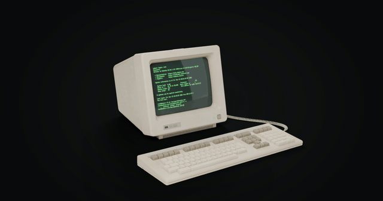

# terminal

[](https://github.com/dubsector/terminal/actions/workflows/ci.yml)
[](https://github.com/dubsector/terminal/actions/workflows/github-code-scanning/codeql)
[](https://github.com/dubsector/terminal/network/updates)

The site at [dubsector.dev](https://dubsector.dev): a DS-220, a made-up video terminal in the
VT220 family, sitting on a desk in a room at dusk, that you can type into.



## What's on the page

**The room.** The terminal, its keyboard, the desk, a desk lamp and the room around them are
modelled and lit in Blender ([tools/blender](tools/blender)) and drawn in WebGL with three.js
([src/scene.js](src/scene.js), [src/gl](src/gl)). The lighting is baked into light maps in three
layers (the room, the desk lamp, the glow of the screen), so the page can switch the lamp and
the ceiling light on and off and brighten the room with what's on the screen without lighting
anything at run time. A visit starts with the room dark, lit only by the lamp and the screen,
until the fluorescent tube overhead flickers on the way a cold one does: it strikes, drops out,
strikes again and warms up (`CEILING_STEPS` in `src/scene.js`). Visitors who ask for reduced
motion get a plain fade instead.

**The screen.** The tube is modelled too: a curved faceplate with its own reflection of the
room, long-persistence P39 phosphor that leaves ghosts behind scrolling text, and an 80 x 25
text raster drawn from a hand-made 9 x 14 dot character ROM
([src/gl/font9x14.js](src/gl/font9x14.js)). The power button on the front works, and so does the
rocker switch on the lamp cord.

**The keyboard.** Every key goes down when the matching key on your keyboard does, a key
clicked or tapped on the model types into the terminal, and anything the terminal types by
itself presses the keys too. The view drifts with the pointer; in a tall window (a phone) it
sits closer to the screen, and a tap near the bottom looks down at the keys.

**The shell.** The page boots, logs in as root (the login is typed for you; the MOTD shows your
real IP, from the Worker) and runs a short intro that walks into the projects folder. After that
it's a bash prompt. [just-bash](https://github.com/vercel-labs/just-bash) interprets what is
typed against an in-memory disk ([src/shell](src/shell)), so pipes, quoting, variables, globs,
`if` and `for` all work, and the machine's `free`, `df`, `ps` and `uptime` agree with the
figures in the login banner. The command line in front of it is our own
([src/readline.js](src/readline.js)) and edits the way readline does: history and `!!`, Ctrl+R
search, Tab completion, word movement, kill and yank. `ls` prints folders and URLs as links you
can click. The site's links live in [src/shell/links.json](src/shell/links.json): each one is a
file at the path its URL spells, so adding a URL there is all it takes to list it. `exit` drops
you at a real login prompt with no way back in short of reloading.

**The Linux machine.** `reboot` doesn't restart that machine. It brings up a GRUB menu, and after
five seconds boots a real one: Alpine Linux
on a 32-bit PC emulated in the page by [v86](https://github.com/copy/v86), with the terminal on
its serial console ([src/linux.js](src/linux.js)). It has bash, nano, less, htop and tree, the
site's links laid onto its disk under `/var/www/dubsector.dev` as it starts, and no network.
`poweroff` (there or on the first machine) brings you back to the first machine's login. The
emulator and image are only downloaded when someone asks for them. The menu has a few other entries too: the
first machine again, and a couple of novelty systems ([src/distros.js](src/distros.js)) that are
that same machine under another name, banner and phosphor colour. `reboot hannah` and
`reboot redstar` go straight to them.

**The flat site.** Underneath the scene, xterm.js runs the real terminal: it takes the
keystrokes and owns the shell, and the scene redraws its buffer on the tube. When WebGL can't
run, the model takes too long to load, or the visitor asks for reduced motion or to save data,
that terminal is what they see, in a CSS CRT with its own power button. `?gl=0` always gives the
flat site and `?gl=1` always tries the scene.

**Link previews and search.** `index.html` carries Open Graph and Twitter cards, a JSON-LD
`WebSite` description, a canonical URL, `robots.txt` and `sitemap.xml`, and an offscreen header
that says in words what the terminal draws, with the site's links in it, for search engines and
screen readers. The preview image is the spinning GIF above (`og:image`; Discord animates it,
most apps show its first frame), with a sharper still for X (`twitter:image`).

## Layout

| Path | What it is |
|---|---|
| `src/terminal.js` | Page entry: xterm.js, boot, login, intro, power, `cmatrix`, the hand-off to Linux. |
| `src/readline.js` | The command line editor. |
| `src/shell.js`, `src/shell/` | The shell (just-bash), the machine's disk and its commands. Its own script, loaded alongside the page. |
| `src/scene.js`, `src/gl/` | The WebGL scene: tube, model loading, keys, legends, camera, desk props. |
| `src/linux.js` | The v86 machine behind `reboot`, loaded only when it is needed. |
| `src/distros.js` | The other systems on the boot menu: banners, MOTDs, colours and habits. |
| `src/worker.js` | Cloudflare Worker: `/api/whoami`, the Matomo proxy, then the static assets. |
| `src/analytics.js` | Matomo tracking. |
| `src/assets/` | The baked model and light maps (written by `tools/blender/build_scene.py`). |
| `src/share/` | Link-preview images (written by `tools/share/make.mjs`). |
| `build.mjs` | esbuild, plus copying assets under content-hashed names and unpacking the Linux image. |
| `tools/blender/` | Blender scripts that model, bake and export the scene and render the share preview. |
| `tools/alpine/` | Builds the Alpine image for the Linux machine. |
| `tools/share/` | Turns the share-preview frames into the GIF and still. |
| `tools/shell-check/` | Compares the shell with real bash. |

## Development

```sh
npm install
npm run dev    # esbuild --watch, writes to dist/
npm run build  # production build to dist/
```

`npx wrangler dev` serves `dist/` with the Worker in front of it, which `/api/whoami` and the
analytics endpoints need; run it alongside `npm run dev`.

The build downloads the Linux image from the GitHub release pinned in
[tools/alpine/image.json](tools/alpine/image.json), checks its hash, caches it under
`node_modules/.cache/alpine` and unpacks it into `dist/linux/`. `ALPINE_IMAGE=<path to an
image.tar>` uses a local build instead.

`npm run check:shell` runs the scripts in `tools/shell-check/cases.mjs` in real bash and in the
site's shell and reports any that print something different. It needs bash: the system's on
Linux and macOS, WSL's on Windows. CI runs it, with the build, on every pull request that
touches code.

### The 3D scene

The model and light maps in `src/assets/` are generated, not hand-made. They are rebuilt with
Blender 5.2 running headless:

```sh
blender -b --factory-startup --python tools/blender/build_scene.py -- --bake-dir <scratch dir>
```

A full bake is about 20 minutes on an RTX 3070. [tools/blender/README.md](tools/blender/README.md)
has the flags, the quick low-quality run, and the contract between the model and the page:
object names, custom properties and how the light maps are decoded.

### The Linux image

```sh
sudo tools/alpine/rootfs.sh <work dir> rootfs.tar
node tools/alpine/pack.mjs image rootfs.tar image.tar
```

`rootfs.sh` needs root on x86-64 Linux (WSL works) and `pack.mjs` needs
[uv](https://docs.astral.sh/uv/), for v86's own Python tools. Publish `image.tar` as a release
and pin its URL and SHA-256 in `tools/alpine/image.json`. The site's links are not in the image,
so changing them never needs a new one.

### The share preview

```sh
blender -b --factory-startup --python tools/blender/render_share.py -- --out <scratch dir>
node tools/share/make.mjs <scratch dir>
```

`render_share.py` renders one full turn of the terminal and keyboard (60 frames and a large
still, about ten minutes); `make.mjs` needs ffmpeg and writes `src/share/terminal.gif` and
`src/share/terminal.jpg`.

## Deploy

Deploys to Cloudflare Workers (static assets plus `src/worker.js`) through Cloudflare's git
integration, watching `main`. Build command: `npm run build`. Deploy command:
`npx wrangler deploy`. Other branches get preview versions.

## Analytics

Cookieless, self-hosted [Matomo](https://matomo.org/). Pageviews, plus `terminal` events for
each command a visitor types by hand (`command`), each folder link they click (`click`) and each
outbound link (`outlink`). What the intro types is not counted. It only runs on `dubsector.dev`,
so branch previews and local dev stay out of the stats.

The tracker is proxied through the Worker (`/mtm/mtm.js` and `/mtm/mtm.php`) so the browser only
ever talks to `dubsector.dev`. Two Worker secrets drive it:

```sh
npx wrangler secret put MATOMO_ORIGIN   # https://analytics.example.com
npx wrangler secret put MATOMO_SITE_ID  # site id for dubsector.dev
```

With either unset, `/api/analytics` returns 204 and the client never loads the tracker. The
visitor IP is forwarded as `X-Visitor-IP`, so Matomo needs
`proxy_client_headers[] = "HTTP_X_VISITOR_IP"` under `[General]` in `config.ini.php`, otherwise
every visit is logged as whatever proxy sits in front of it. It can't ride in `X-Forwarded-For`:
the subrequest crosses Cloudflare's edge on its way to Matomo, and the edge rewrites that header
to the connecting IP of its own leg.
